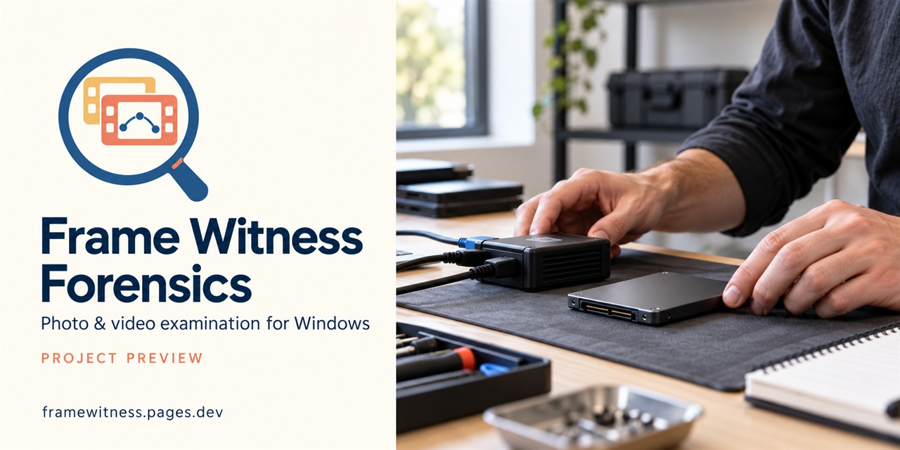
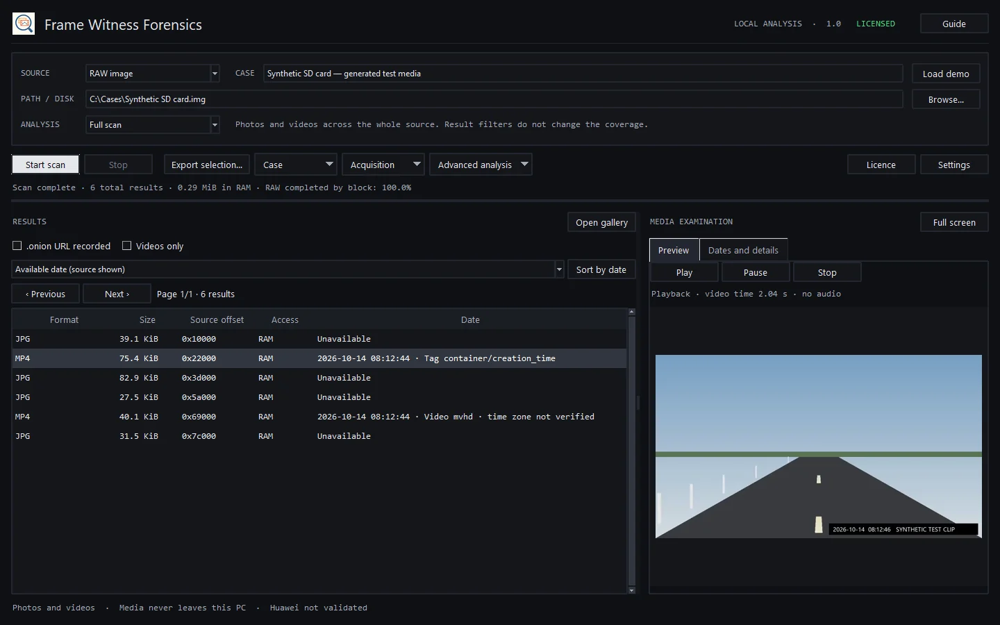
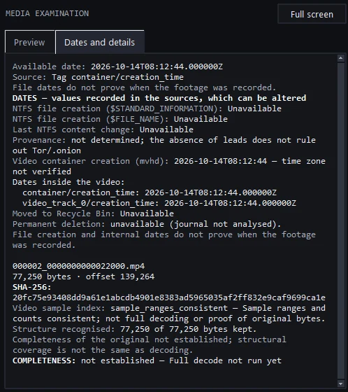
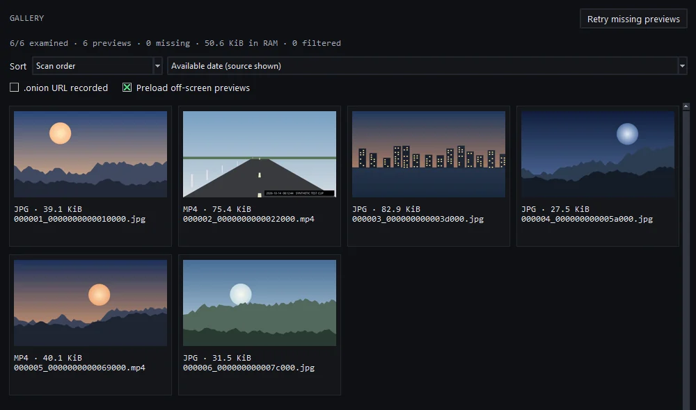

# Frame Witness Forensics — Windows Photo and Video Recovery

For Windows users examining recoverable photos and videos. Move from a supported disk or image to media candidates with source offsets, SHA-256 hashes and available dates; a preview alone does not prove complete recovery.

[Product](https://framewitness.pages.dev/#product) · [Official Windows downloads](https://github.com/AurelioAvila/frame-witness/releases/latest) · [Verify the publisher signature](https://github.com/AurelioAvila/.github/blob/master/CODE_SIGNING.md)

**Example workflow:** open a supported disk image → review a photo/video candidate → inspect its source offset and SHA-256 record → export recovered media to a different physical destination. Missing dates remain unknown, and a playable preview does not establish that the original file is complete.

**Photo and video recovery for Windows. Visual review with source context.**

Examine recoverable media on physical SSDs, hard drives and supported disk images.
Move from a file candidate to a visual review, then inspect its source offsets,
SHA-256 hash and available dates without leaving the examination workflow.

**Windows release available** · Windows desktop · Local media analysis · Proprietary software

[Explore the product](https://framewitness.pages.dev/#product) ·
[Examination workflow](#examination-workflow) ·
[Release status](#release-status) ·
[Useful links](#useful-links)

---

## See the media. Keep the context.

Frame Witness is focused on photo and video examination. Its development
workflow combines visual triage with the technical details needed to assess a
finding. A playable frame is an observation; it does not prove that the complete
original survived.

| Examination task | What the workflow provides |
| :--- | :--- |
| **Review candidates visually** | A media gallery, local previews and playback, with sorting by size or available date. |
| **Search surviving content** | Filesystem records and RAW media structures, including supported remnants when current metadata is absent. |
| **Retain source context** | Recorded offsets, SHA-256 hashes and available filesystem information alongside the media. |
| **Read dates with their source** | Filesystem, container and surviving Recycle Bin dates are distinguished; missing dates remain unknown. |
| **Assess recovery quality** | Structural recognition, a decoded frame and complete-file verification remain separate checks. |
| **Keep media local** | Examination runs on the Windows workstation. Scanner and decoder workers use AppContainer isolation. |

## Inside the Windows workspace

*Application screenshot from the existing product demonstration, using generated test media. The six candidates and the clip are synthetic examples; they are not customer files or a recovery-rate benchmark. This is not a new native-release validation.*

Inspect source details and the gallery

The details keep the source offset and SHA-256 record beside the limits of the examination. A recognized structure and a playable preview do not establish that the original file is complete. Missing dates remain unavailable.

The gallery supports visual triage. These generated test cards show the interface; they do not demonstrate recovery from a failing disk, a real phone or overwritten data.

[Image provenance and verification limits](docs/SCREENSHOTS.md). The cover above remains an illustration.

## Examination workflow

1. **Choose and preserve the source.** Select a supported image or physical disk.
   Prefer an acquired image and a write blocker where appropriate; Windows keeps
   changing a live system disk even when the application only reads it.
2. **Search what remains.** Examine filesystem records and recognizable media
   structures. A metadata filter can exclude items whose metadata did not survive.
3. **Review and verify.** Inspect candidates in the gallery and player, then
   compare their source details, dates and structural findings.
4. **Export with context.** Use a different physical destination for recovered
   media to avoid overwriting potential remnants on the source.

## Useful links

| Destination | What you will find |
| :--- | :--- |
| [Official website](https://framewitness.pages.dev) | Product overview and current availability. |
| [Features and synthetic demo](https://framewitness.pages.dev/#product) | Visual review, source context and local examination. |
| [Workflow and recovery limits](https://framewitness.pages.dev/#workflow) | Source preservation, search, examination and export. |
| [Plans and indicative pricing](https://framewitness.pages.dev/#pricing) | Professional, Lab and Organization licences, with a Halloween offer until 6 November 2026. |
| [Account and licences](https://framewitness.pages.dev/account.html) | Email/password sign-in, credential management, orders, licences and private product support. |
| [Create an account](https://framewitness.pages.dev/#register) | Register or sign in on the homepage; registration is free. |
| [Frequently asked questions](https://framewitness.pages.dev/#questions) | Deleted files, earlier formats, Tor clues, dates and device scope. |
| [Deleted video recovery](https://framewitness.pages.dev/video-recovery) | Surviving records, RAW carving, SSD limits and a reporting checklist. |
| [Tor video traces](https://framewitness.pages.dev/tor-video-traces) | Acquired artifacts and the limits of browser attribution. |
| [Examiner workflow discussion](https://github.com/AurelioAvila/frame-witness/discussions/1) | Share requirements and synthetic examples; no case evidence or sensitive data. |
| [Release channel](https://github.com/AurelioAvila/frame-witness/releases) | Publisher-signed Windows releases with SHA-256 checksums. A free account includes the quick scan, previews and saving recovered files up to 1 MB per file. Since version 1.0.14 there is a 3-day free trial of everything, once per person and per computer; after it, larger files and advanced tools require a licence. |
| [Legal information](https://framewitness.pages.dev/legal.html) | Seller information, account data and the [terms of sale and licence](https://framewitness.pages.dev/terms). |

## Release status

**Version 1.0.15 is available as a signed Windows release.** It brings clearer, more accurate translations in every language: German, Spanish, French, Italian and European Portuguese were reviewed in full against the English interface. Since 1.0.14 there is a free trial: three days of everything (full and deep scans, every result, saving files of any size and all the advanced tools), once per person and per computer, with no payment details, started from the account area. The free quick scan now also counts the results it does not show. An update leaves one installation, Windows itself checks the signature of an update inside the app, and a scan can keep running in the background with the window closed. The app starts in English; German, Spanish, French, Italian and European Portuguese can be chosen in Settings. It installs for all users in Program Files, so installing asks for administrator approval.
[Download the signed installer](https://github.com/AurelioAvila/frame-witness/releases/download/v1.0.15/FrameWitness-Setup-1.0.15.exe)
(82.7 MiB) and [read the release notes](https://github.com/AurelioAvila/frame-witness/releases/tag/v1.0.15). Coming from 1.0.9, run this installer: the update inside 1.0.9 cannot install it.
A free account includes the quick scan of the first 8 GB (the first 100 results shown, the rest counted), previews and saving recovered files up to 1 MB per file. After the trial, larger files and advanced tools require a licence; registration alone does not issue one.

SHA-256: `438ff59352c257b96a35192b561294b0a5a4844dbb4da17be50b493c3f967a6c`.
Publisher: Aurelio Avila. Trusted timestamp: Certum.

Local synthetic recovery, preview, playback, isolation and licence checks passed.
The 1.0.10 installer, built the same way, was installed, started and uninstalled on a clean
Windows 11 virtual machine by a standard user. Windows 10 and physically failing hardware
have not been tested yet.

Licences are sold from the account area. Halloween offer, until 6 November 2026,
23:59 Rome time: €235 for Professional (1 workstation), €580 for Lab (3) and
€900 for Organization (5), about 50% below the lowest price applied in the 30 days
before the offer began (€472, €1,160.70 and €1,802.30). Each is a perpetual licence
with 12 months of updates. Licences are delivered immediately and are not
refundable; see the [terms of sale and licence](https://framewitness.pages.dev/terms).

The application source is maintained separately in a private repository.
This public presentation does not grant an open-source licence to the product.
Before operational use, evaluate the current release against representative
sources and your organization's requirements.

The release identifies the signed installer and its checksum. Verify
the final artifact before installation. Signing establishes publisher identity
and integrity when verified; it does not guarantee the absence of vulnerabilities
or Windows reputation warnings.

## What recovery can establish

- **Deletion and earlier formats:** recovery depends on accessible surviving
  bytes, fragmentation and supported structures. Overwritten or TRIM-erased
  data cannot be promised.
- **Tor and .onion clues:** available metadata or acquired residues may provide
  leads. An onion reference is not proof that Tor downloaded a video; absent
  artifacts do not rule out browser use.
- **Dates:** recorded timestamps are source values, not proof of recording time
  or a complete deletion history.
- **Isolation:** AppContainer reduces exposure while processing untrusted
  data; it is not an absolute security guarantee.
- **Professional suitability:** no police certification, institutional
  endorsement or superiority over competing tools is claimed.

---

**Focused on:** digital media forensics · photo and video recovery · file carving ·
disk-image examination · Windows storage analysis · visual triage · verification

[Visit Frame Witness](https://framewitness.pages.dev) ·
[Copyright and third-party rights](COPYRIGHT.txt)

## More tools by Aurelio Avila

- [PC Tweaker](https://pctweaker.app/): Windows tuning for performance, gaming and privacy, with hardware monitoring and restore tools for supported settings.
- [PC Tweaker Uninstaller](https://pctweaker.app/uninstaller/): Windows uninstaller with evidence-based removal scores, rollback snapshots and a local removal ledger.
- [Tweaky Driver](https://pctweaker.app/tweaky-driver/): Windows driver inventory and update review, showing detected devices, installed versions and available driver offers.
- [Redaxa](https://redaxa.getcertsprint.com/): Sensitive-data checks and redaction for AI prompts, plus local repository secret reviews on Windows.
- [Redexa Social](https://redexa.getcertsprint.com/): Private YouTube analytics for Windows, kept in a database on your PC.
- [Glarion](https://glarion.app/): Verified website security checks and white-label reports for digital agencies.
